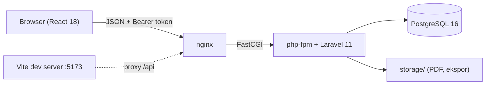
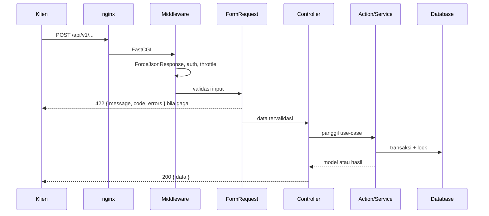
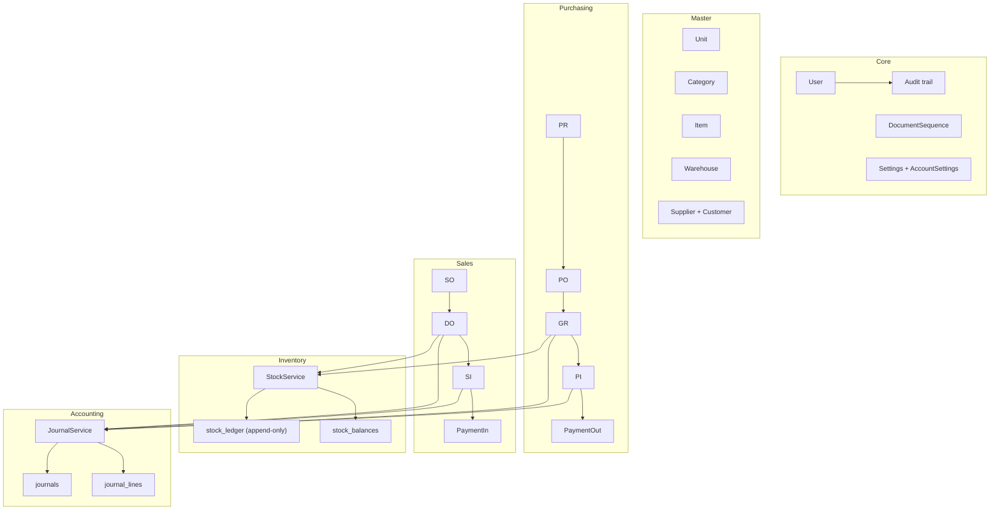
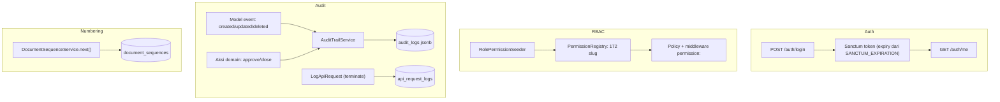
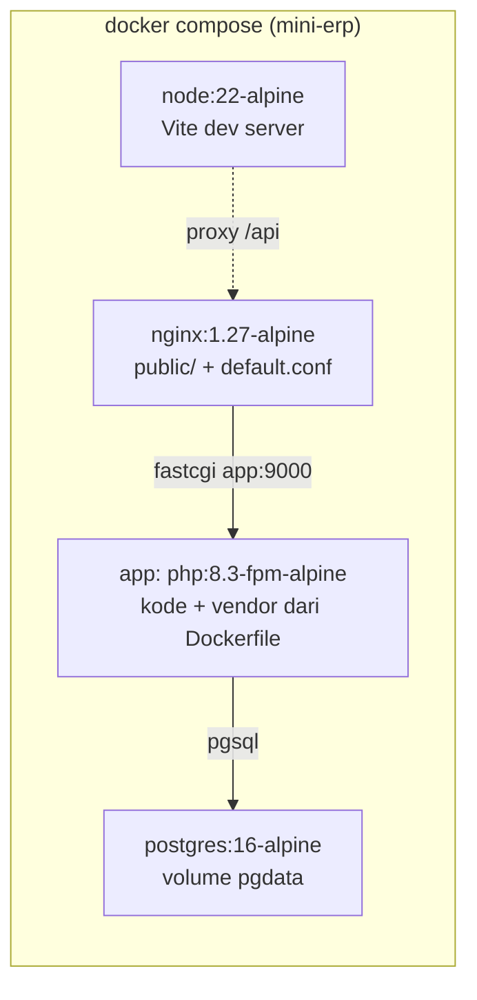

# Arsitektur Mini ERP

Dokumen ini tumbuh per fase. Fase 0 menetapkan kerangka: bagaimana request masuk, bagaimana respons dibentuk, dan bagaimana lapisan domain akan disusun.

## Diagram komponen

## Alur satu request

Aturan yang berlaku sejak awal:

- Controller tipis, hanya orkestrasi. Logika bisnis di Action atau Service per use-case.
- Validasi selalu lewat FormRequest. Tidak ada `$request->validate()` di controller.
- Kesalahan domain dilempar sebagai `App\Exceptions\ApiException` dengan kode mesin, misalnya `STOCK_INSUFFICIENT`, sehingga klien tidak perlu membaca teks pesan.
- Semua query memakai binding. Nama kolom untuk sort dan filter divalidasi terhadap daftar putih per resource.

## Format respons

| Kasus | Bentuk |
| --- | --- |
| Sukses tunggal | `{ "data": { ... } }` |
| Sukses daftar | `{ "data": [...], "meta": { current_page, per_page, last_page, total, from, to }, "links": { first, prev, next, last } }` |
| Gagal | `{ "message": "...", "code": "SNAKE_CASE", "errors": { "field": ["..."] } }` |

Status yang dipakai: 200, 201, 401, 403, 404, 405, 409, 422, 429, 500.

## List endpoint

`App\Support\Api\ListQuery` menangani `?search=`, `?filter[kolom]=nilai`, `?filter[kolom][operator]=nilai`, `?sort=`, `?page=`, `?per_page=`.

- Operator filter yang didukung: `eq`, `gte`, `lte`, `gt`, `lt`, `from`, `to`, `like`, `in`.
- Kolom yang boleh dipakai didaftarkan per resource. Kolom di luar daftar diabaikan.
- Nama kolom divalidasi dengan pola identifier, nilai dikirim sebagai binding, dan wildcard `%` serta `_` pada pencarian di-escape.
- `per_page` dibatasi maksimum 100.

## Lapisan domain yang akan dibangun

Dua pintu mutasi yang dijaga:

- `StockService` satu-satunya penulis `stock_ledger` dan `stock_balances`. Ledger append-only, saldo diperbarui dengan moving average dan lock `FOR UPDATE` berurutan `item_id, warehouse_id`.
- `JournalService` satu-satunya penulis `journals` dan `journal_lines`. Jurnal wajib seimbang, periode harus open, dan akun harus postable.

## Modul Core (Fase 1)

### Auth

- Login memakai `Hash::check`, bukan `Auth::attempt`, karena API tidak memakai session. Kredensial salah selalu menghasilkan `401 INVALID_CREDENTIALS` dengan pesan sama, sehingga tidak membocorkan email terdaftar.
- Status nonaktif hanya diungkap setelah password terbukti benar (`403 USER_INACTIVE`), jadi penyerang tanpa password tidak dapat memetakan akun.
- Token dibuat dengan `expiresAt` eksplisit; `SANCTUM_EXPIRATION` (menit) menjadi satu-satunya sumber kebenaran.
- `/auth/me` mengembalikan role dan permission efektif, dipakai frontend untuk menyusun menu.
- Logout menghapus token yang sedang dipakai, bukan seluruh token pengguna.

#### Siklus hidup token

| Kejadian | Efek |
| --- | --- |
| Password diubah oleh pemilik akun | Seluruh token lain dicabut, token yang dipakai tetap berlaku |
| Password diubah admin untuk user lain | Seluruh token user tersebut dicabut |
| Akun dinonaktifkan (`is_active=false`) | Seluruh token dicabut; token yang beredar ditolak `403 USER_INACTIVE` |
| Akun di-soft-delete | Seluruh token dicabut; token yang beredar ditolak `401` karena Sanctum tidak dapat me-resolve user terhapus |

Middleware `EnsureUserIsActive` dipasang setelah `auth:sanctum`, sehingga pemeriksaan status berjalan setelah token valid. Urutan ini penting: pengguna tanpa token tetap menerima `401`, bukan `403`.

### RBAC

- `PermissionRegistry` adalah sumber tunggal: modul, resource, aksi, pola per role. Seeder, test, dan (nanti) menu frontend membaca daftar yang sama.
- Role disusun dari pola wildcard (`purchase.*.*`, `*.view`) lalu diekspansi menjadi slug konkret. Menambah resource cukup mengubah satu array.
- Otorisasi di backend memakai Policy per model (`UserPolicy`, `AuditLogPolicy`) dan middleware `permission:` untuk endpoint yang tidak punya model.
- Admin tidak memakai `Gate::before` yang membuka semua aksi; ia memegang seluruh permission lewat seeder. Alasannya: `Gate::before` juga melewati aturan proteksi seperti "tidak boleh menghapus akun sendiri".

### Audit trail

- Trait `Auditable` memasang hook `created`, `updated`, `deleted` dan menulis lewat `AuditTrailService`.
- `old_values`, `new_values`, dan `diff` disimpan sebagai jsonb; atribut sensitif (`password`, `remember_token`) dikecualikan di model.
- `updated` hanya tercatat bila ada atribut yang benar-benar berubah, sehingga audit tidak dipenuhi baris kosong.
- Event domain (`approved`, `disapproved`, `closed`, `period_closed`) akan memanggil `AuditTrailService::record()` langsung dari Action, karena bukan siklus hidup Eloquent.
- Pelaku diambil dari `request()->user()` lebih dulu, lalu `Auth::id()`. `Auth::id()` saja tidak cukup karena guard default adalah `web`, sedangkan API memakai `sanctum`.
- `LogApiRequest` memakai `terminate()` agar penulisan log terjadi setelah respons dikirim dan tidak memperlambat pengguna. Yang disimpan hanya method, path (tanpa query string), status, durasi, IP, dan user agent. Body dan header tidak pernah disimpan, sehingga password dan bearer token tidak masuk database log.

### Mode demo

- `BlockDemoWrites` (`demo.readonly`) memblokir POST/PUT/PATCH/DELETE pada path `users`, `roles`, `settings`, dan `account-settings` ketika `DEMO_MODE=true`, dengan `403 DEMO_MODE_READONLY`.
- Middleware dipasang setelah `auth:sanctum` dan `active`, sehingga permintaan tanpa token tetap `401` dan urutan kesalahan tidak menyesatkan.
- Transaksi bisnis (PO, GR, invoice, dan seterusnya) sengaja tidak diblokir agar pengunjung demo dapat mencoba alur lengkap.
- `demo:reset` adalah perintah artisan, jadi tidak melewati middleware HTTP dan tetap bisa memulihkan data.
- `DEMO_MODE` wajib `true` pada deploy publik; lihat README.

### Penomoran dokumen

Lihat [ADR 0002](ADR/0002-document-numbering-locking.md). Ringkas: `insertOrIgnore` untuk membuat baris periode, `lockForUpdate` untuk menaikkan nomor, unique index sebagai jaring pengaman, dan retry transaksi saat deadlock.

### Settings

- Nilai default didefinisikan di `SettingService::DEFAULTS`, bukan hanya di seeder, sehingga instalasi baru dan test berperilaku sama.
- Akses bertipe: `bool()`, `int()`, `decimal()`, `get()` dengan fallback.
- `account_settings` sudah ada tetapi belum berisi baris; pemetaan akun diisi pada Fase 2 bersama tabel `accounts`.

## Keamanan

- Sanctum bearer token dengan masa berlaku dari `SANCTUM_EXPIRATION`.
- Rate limit `api` per user atau IP, rate limit `login` per email dan IP.
- CORS dibatasi ke origin yang didaftarkan di `CORS_ALLOWED_ORIGINS`.
- Respons error tidak pernah membocorkan stack trace. Detail internal hanya masuk log.
- `.env` tidak masuk repo, hanya `.env.example`.
- Dokumen OpenAPI terbuka secara default untuk demo (`API_DOCS_PUBLIC=true`); matikan bila instance memakai data nyata.

## Container

Dua cara image dipakai:

| Konteks | Berkas Compose | Kode aplikasi |
| --- | --- | --- |
| Pengembangan lokal | `docker-compose.yml` + `docker-compose.override.yml` (otomatis) | Bind mount `./backend`, `vendor` dipasang entrypoint bila belum ada |
| CI dan demo | `docker-compose.yml` saja | Hasil `COPY` di Dockerfile, tanpa bind mount |

Dockerfile memakai tiga tahap: `base` (php:8.3-fpm-alpine dengan ekstensi `pdo_pgsql`, `bcmath`, `intl`, `zip`, `gd`, `opcache`), `vendor` (Composer memasang dependensi di atas `base` yang sama), dan runtime yang menyalin kode serta vendor. Karena `vendor` memakai `base`, Composer memverifikasi requirement terhadap platform yang identik dengan runtime, bukan image Composer yang PHP-nya berbeda. Entrypoint menyiapkan `.env`, menulis koneksi database dari environment Compose, menghasilkan `APP_KEY`, dan menyesuaikan kepemilikan `storage` serta `bootstrap/cache` untuk user `www-data`. Karena image sudah membawa vendor, container di CI siap tanpa `composer install` saat runtime.

Koneksi database ditulis eksplisit ke `.env` oleh entrypoint, bukan hanya mengandalkan variabel lingkungan container. Alasannya: perilaku `clear_env` pada php-fpm dan urutan prioritas dotenv berbeda antar setup, dan salah satu kombinasi bisa membuat worker menyambung ke `127.0.0.1` alih-alih service `postgres`.

`.dockerignore` mengecualikan `backend/vendor`, `**/.env`, dan `frontend`, sehingga konteks build kecil dan tidak pernah membawa rahasia dari mesin pengembang. `.gitattributes` memaksa LF pada `*.sh`, `Dockerfile`, dan `Makefile` agar checkout di Windows tidak merusak `#!/bin/sh`.

## Verifikasi Docker

Job `docker-smoke` di CI menjalankan urutan yang sama dengan `make smoke`:

1. `docker compose config --quiet`.
2. `docker compose build`.
3. `docker compose up -d --wait --wait-timeout 180 postgres app nginx` (tiga menit untuk ketiga layanan backend healthy).
4. `docker compose exec -T app php artisan migrate --force`.
5. `curl` ke `/api/v1/health`, wajib HTTP 200 dan `checks.database = ok` (divalidasi `jq`).
6. `docker compose logs postgres app nginx` bila gagal, lalu `docker compose down -v --remove-orphans`.

Karena job ini tidak memuat `docker-compose.override.yml`, image yang diuji adalah image yang benar-benar dipakai untuk demo.

Layanan `node` sengaja tidak dinyalakan. Endpoint health hanya bergantung pada postgres, php-fpm, dan nginx; frontend sudah diuji job `frontend` (ESLint, typecheck, build). Akibatnya job smoke tidak menarik image Node, tidak menjalankan `npm ci`, dan tidak bergantung pada registry npm.

Konsekuensi yang perlu diketahui: `make smoke` dan job CI tidak lagi memvalidasi integrasi Vite di dalam Compose. Perubahan pada `frontend/docker-entrypoint.sh` atau konfigurasi proxy hanya teruji saat `make demo` dijalankan manual.

## Kualitas

- Pint dengan `declare(strict_types=1)` dan urutan import.
- Larastan level 6 pada `app`, `routes`, dan `database`.
- Pest dengan `RefreshDatabase`, memakai database PostgreSQL terpisah.
- ESLint dan `tsc` strict untuk frontend.

## Batasan fase 0

- Belum ada endpoint domain, login, maupun seeder data.
- ERD dan ADR ditulis saat modul terkait mulai diimplementasikan, agar isinya sesuai kode yang ada.
- Docker tidak tersedia di mesin pengembangan ini, sehingga stack Compose tidak dijalankan manual di sana. Kebenarannya dijaga oleh job `docker-smoke`; berkas Compose dan workflow sudah divalidasi sintaksnya secara lokal.
