# Arsitektur Mini ERP

Dokumen ini tumbuh per fase. Fase 0 menetapkan kerangka: bagaimana request masuk, bagaimana respons dibentuk, dan bagaimana lapisan domain akan disusun.

## Diagram komponen

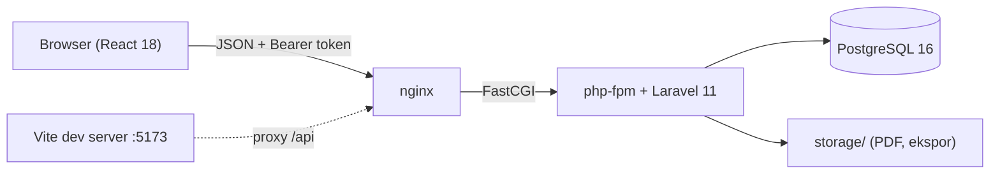

## Alur satu request

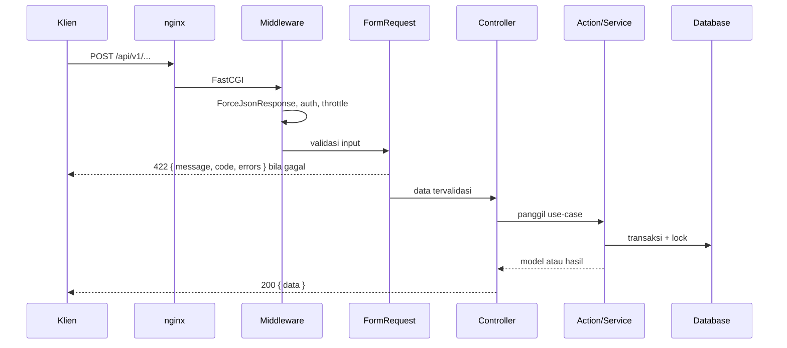

Aturan yang berlaku sejak awal:

- Controller tipis, hanya orkestrasi. Logika bisnis di Action atau Service per use-case.
- Validasi selalu lewat FormRequest. Tidak ada `$request->validate()` di controller.
- Kesalahan domain dilempar sebagai `App\Exceptions\ApiException` dengan kode mesin, misalnya `STOCK_INSUFFICIENT`, sehingga klien tidak perlu membaca teks pesan.
- Semua query memakai binding. Nama kolom untuk sort dan filter divalidasi terhadap daftar putih per resource.

## Format respons

| Kasus | Bentuk |
| --- | --- |
| Sukses tunggal | `{ "data": { ... } }` |
| Sukses daftar | `{ "data": [...], "meta": { current_page, per_page, last_page, total, from, to }, "links": { first, prev, next, last } }` |
| Gagal | `{ "message": "...", "code": "SNAKE_CASE", "errors": { "field": ["..."] } }` |

Status yang dipakai: 200, 201, 401, 403, 404, 405, 409, 422, 429, 500.

## List endpoint

`App\Support\Api\ListQuery` menangani `?search=`, `?filter[kolom]=nilai`, `?filter[kolom][operator]=nilai`, `?sort=`, `?page=`, `?per_page=`.

- Operator filter yang didukung: `eq`, `gte`, `lte`, `gt`, `lt`, `from`, `to`, `like`, `in`.
- Kolom yang boleh dipakai didaftarkan per resource. Kolom di luar daftar diabaikan.
- Nama kolom divalidasi dengan pola identifier, nilai dikirim sebagai binding, dan wildcard `%` serta `_` pada pencarian di-escape.
- `per_page` dibatasi maksimum 100.

## Lapisan domain yang akan dibangun

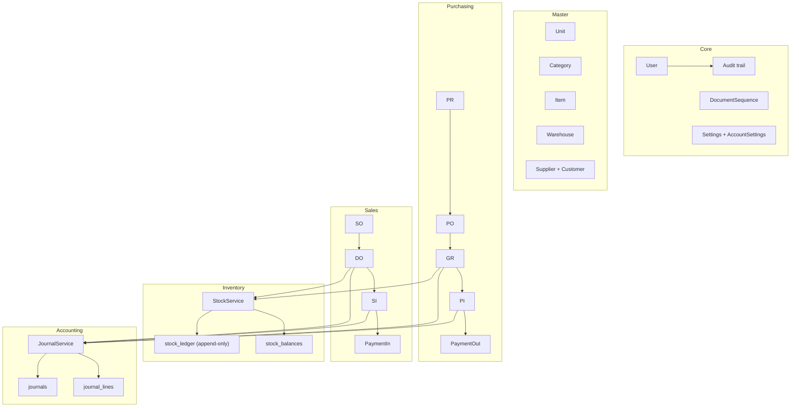

Dua pintu mutasi yang dijaga:

- `StockService` satu-satunya penulis `stock_ledger` dan `stock_balances`. Ledger append-only, saldo diperbarui dengan moving average dan lock `FOR UPDATE` berurutan `item_id, warehouse_id`.
- `JournalService` satu-satunya penulis `journals` dan `journal_lines`. Jurnal wajib seimbang, periode harus open, dan akun harus postable.

## Modul Core (Fase 1)

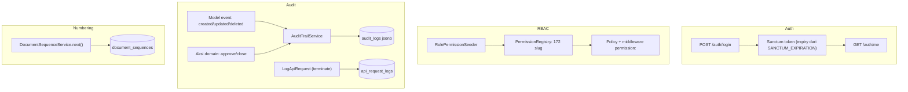

### Auth

- Login memakai `Hash::check`, bukan `Auth::attempt`, karena API tidak memakai session. Kredensial salah selalu menghasilkan `401 INVALID_CREDENTIALS` dengan pesan sama, sehingga tidak membocorkan email terdaftar.
- Status nonaktif hanya diungkap setelah password terbukti benar (`403 USER_INACTIVE`), jadi penyerang tanpa password tidak dapat memetakan akun.
- Token dibuat dengan `expiresAt` eksplisit; `SANCTUM_EXPIRATION` (menit) menjadi satu-satunya sumber kebenaran.
- `/auth/me` mengembalikan role dan permission efektif, dipakai frontend untuk menyusun menu.
- Logout menghapus token yang sedang dipakai, bukan seluruh token pengguna.

#### Siklus hidup token

| Kejadian | Efek |
| --- | --- |
| Password diubah oleh pemilik akun | Seluruh token lain dicabut, token yang dipakai tetap berlaku |
| Password diubah admin untuk user lain | Seluruh token user tersebut dicabut |
| Akun dinonaktifkan (`is_active=false`) | Seluruh token dicabut; token yang beredar ditolak `403 USER_INACTIVE` |
| Akun di-soft-delete | Seluruh token dicabut; token yang beredar ditolak `401` karena Sanctum tidak dapat me-resolve user terhapus |

Middleware `EnsureUserIsActive` dipasang setelah `auth:sanctum`, sehingga pemeriksaan status berjalan setelah token valid. Urutan ini penting: pengguna tanpa token tetap menerima `401`, bukan `403`.

### RBAC

- `PermissionRegistry` adalah sumber tunggal: modul, resource, aksi, pola per role. Seeder, test, dan (nanti) menu frontend membaca daftar yang sama.
- Role disusun dari pola wildcard (`purchase.*.*`, `*.view`) lalu diekspansi menjadi slug konkret. Menambah resource cukup mengubah satu array.
- Otorisasi di backend memakai Policy per model (`UserPolicy`, `AuditLogPolicy`) dan middleware `permission:` untuk endpoint yang tidak punya model.
- Admin tidak memakai `Gate::before` yang membuka semua aksi; ia memegang seluruh permission lewat seeder. Alasannya: `Gate::before` juga melewati aturan proteksi seperti "tidak boleh menghapus akun sendiri".

### Audit trail

- Trait `Auditable` memasang hook `created`, `updated`, `deleted` dan menulis lewat `AuditTrailService`.
- `old_values`, `new_values`, dan `diff` disimpan sebagai jsonb; atribut sensitif (`password`, `remember_token`) dikecualikan di model.
- `updated` hanya tercatat bila ada atribut yang benar-benar berubah, sehingga audit tidak dipenuhi baris kosong.
- Event domain (`approved`, `disapproved`, `closed`, `period_closed`) akan memanggil `AuditTrailService::record()` langsung dari Action, karena bukan siklus hidup Eloquent.
- Pelaku diambil dari `request()->user()` lebih dulu, lalu `Auth::id()`. `Auth::id()` saja tidak cukup karena guard default adalah `web`, sedangkan API memakai `sanctum`.
- `LogApiRequest` memakai `terminate()` agar penulisan log terjadi setelah respons dikirim dan tidak memperlambat pengguna. Yang disimpan hanya method, path (tanpa query string), status, durasi, IP, dan user agent. Body dan header tidak pernah disimpan, sehingga password dan bearer token tidak masuk database log.

### Mode demo

- `BlockDemoWrites` (`demo.readonly`) memblokir POST/PUT/PATCH/DELETE pada path `users`, `roles`, `settings`, dan `account-settings` ketika `DEMO_MODE=true`, dengan `403 DEMO_MODE_READONLY`.
- Middleware dipasang setelah `auth:sanctum` dan `active`, sehingga permintaan tanpa token tetap `401` dan urutan kesalahan tidak menyesatkan.
- Transaksi bisnis (PO, GR, invoice, dan seterusnya) sengaja tidak diblokir agar pengunjung demo dapat mencoba alur lengkap.
- `demo:reset` adalah perintah artisan, jadi tidak melewati middleware HTTP dan tetap bisa memulihkan data.
- `DEMO_MODE` wajib `true` pada deploy publik; lihat README.

### Penomoran dokumen

Lihat [ADR 0002](ADR/0002-document-numbering-locking.md). Ringkas: `insertOrIgnore` untuk membuat baris periode, `lockForUpdate` untuk menaikkan nomor, unique index sebagai jaring pengaman, dan retry transaksi saat deadlock.

## Modul Master (Fase 2)

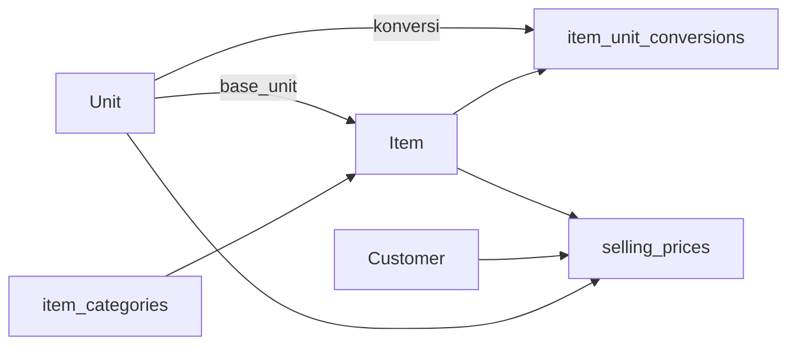

Delapan resource CRUD memakai pola seragam: FormRequest, Policy per model, API Resource, soft delete, dan audit.

### Konversi satuan

- `UnitConversionService` adalah satu-satunya tempat mengubah qty satuan input menjadi `qty_base`, dan sebaliknya menghitung biaya per satuan base. Lihat [ADR 0003](ADR/0003-satuan-base-dan-konversi.md).
- Semua aritmetika memakai `App\Support\Math\Decimal` (bcmath, pembulatan HALF_UP). Tidak ada float.
- Konversi yang tidak terdefinisi menghasilkan `422 UNIT_NOT_CONVERTIBLE`, bukan diam-diam memakai faktor 1.

### Harga jual

- `SellingPriceResolver` memilih baris dengan urutan: harga khusus customer dulu (`customer_id IS NOT NULL`), lalu `valid_from` terbaru, lalu `id` terbesar.
- `valid_from`/`valid_to` null berarti tanpa batas. Tanggal lookup default hari ini, dan bisa dikirim eksplisit lewat `?date=`.
- Endpoint lookup mengembalikan `unit_price_base` hasil `UnitConversionService`, sehingga frontend tidak menghitung ulang.
- `SellingPricePeriodGuard` menolak rentang tumpang tindih untuk kombinasi (item, satuan, customer) yang sama dengan `422 PRICE_PERIOD_OVERLAP`. Batas tanggal inklusif. Constraint `EXCLUDE USING gist` pada `daterange` menjadi jaring pengaman untuk request paralel.
- `unitPriceFromBase()` selalu membulatkan 2 desimal HALF_UP karena hasilnya harga uang, bukan qty.

### Proteksi penghapusan

- `MasterUsageGuard` membaca `config/master_usage.php`: daftar pasangan tabel dan kolom per model, plus `document_tables`.
- Tabel yang belum ada dilewati (`Schema::hasTable`), sehingga modul Purchasing dan Sales cukup menambah entri konfigurasi tanpa mengubah guard.
- Penghapusan yang masih dipakai menghasilkan `409 MASTER_IN_USE` beserta daftar tabel di `errors.references`.
- Perubahan `items.base_unit_id` atau `factor_to_base` pada item yang sudah dipakai tabel dokumen ditolak `409 ITEM_IN_USE`. Mekanisme aktif otomatis begitu tabel dokumen dibuat; test placeholder menandai tabel yang belum ada secara eksplisit.

### Audit dan morph map

- Seluruh master memakai trait `Auditable`, sehingga create/update/delete tercatat lengkap dengan `diff`.
- `Relation::enforceMorphMap` mencantumkan setiap model master. Tanpa entri morph map, audit gagal saat model baru pertama kali disimpan; ini sudah teruji lewat seeder.
- `GET /{resource}/{id}/audit` tersedia untuk semua master lewat trait `InteractsWithAuditTrail`.

### Settings

- Nilai default didefinisikan di `SettingService::DEFAULTS`, bukan hanya di seeder, sehingga instalasi baru dan test berperilaku sama.
- Akses bertipe: `bool()`, `int()`, `decimal()`, `get()` dengan fallback.
- `account_settings` diisi `AccountingSeeder` dengan 15 key akun (persediaan per jenis, GR/IR, AP/AR, PPN, penjualan, HPP, kas/bank, dan variance).

## Modul Akuntansi (Fase 3)

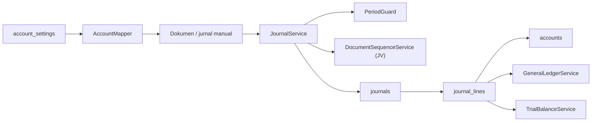

### Skema dan integritas

- `accounts` bertingkat lewat `parent_id`/`level`; akun induk `is_postable=false` tidak boleh dipakai jurnal.
- `journal_lines` memiliki CHECK `debit >= 0 AND credit >= 0 AND NOT (debit > 0 AND credit > 0)`.
- Constraint trigger deferred memastikan jurnal posted/reversed seimbang di database. Draft manual boleh tidak seimbang agar pengguna dapat menyimpan pekerjaan, tetapi approve tetap ditolak `422 JOURNAL_NOT_BALANCED`.
- FK `item_categories.*_account_id` dan `account_settings.account_id` ditambahkan setelah tabel `accounts` ada, dengan `restrictOnDelete`.
- Semua model baru (`Account`, `AccountingPeriod`, `Journal`, `JournalLine`) terdaftar di morph map sejak awal.

### Alur jurnal

- `JournalService::post()` membuat jurnal posted, nomor `JV/YYYY/MM/0000`, baris, dan audit dalam satu `DB::transaction`.
- Jurnal manual dibuat draft tanpa nomor. Nomor diberikan saat approve agar mengikuti tanggal final.
- `reverse()` membuat jurnal baru dengan debit/credit ditukar, lalu menandai jurnal asal `reversed`. Kedua jurnal tetap ada.
- `PeriodGuard::assertOpen()` dipakai semua operasi posting. Periode closed menghasilkan `422 PERIOD_CLOSED`.
- Tutup periode memvalidasi periode sebelumnya, keseimbangan seluruh jurnal, dokumen draft, dan rekonsiliasi. Gagal mengembalikan daftar penyebab di `errors.reasons`.
- Reopen hanya untuk role admin dan tercatat sebagai `period_reopened`.

### Laporan

- General Ledger memakai CTE `opening`/`period` dan window function `SUM(...) OVER (PARTITION BY account_id ORDER BY journal_date, id ROWS BETWEEN UNBOUNDED PRECEDING AND CURRENT ROW)`.
- Trial Balance menghitung saldo awal, mutasi, dan saldo akhir; total debit/kredit harus sama.
- Semua parameter laporan memakai binding; tidak ada nilai tanggal atau id yang dirangkai ke SQL.
- Laba tahun berjalan dihitung dinamis di laporan, tanpa jurnal penutup tahunan. Lihat [ADR 0004](ADR/0004-laba-tahun-berjalan-dinamis.md).

### EXPLAIN ANALYZE General Ledger

Dataset uji: 5.000 jurnal posted, 10.000 baris, satu akun kas, rentang Desember 2026, PostgreSQL 16 lokal.

```
WindowAgg  (actual time=4.684..4.915 rows=338 loops=1)
  Buffers: shared hit=305
  ->  Sort  (Sort Key: jl.journal_date, jl.id)  (actual time=4.675..4.686 rows=338)
        ->  Nested Loop Left Join  (actual time=3.627..4.568 rows=338)
              ->  Index Scan using accounts_pkey on accounts a  (actual time=0.009..0.009 rows=1)
              ->  Bitmap Heap Scan on journal_lines jl  (actual time=0.027..0.075 rows=338)
                    Recheck Cond: ((account_id = '4') AND (journal_date >= '2026-12-01') AND (journal_date <= '2026-12-31'))
                    ->  Bitmap Index Scan on journal_lines_account_date_idx  (actual time=0.023..0.023 rows=338)
                          Index Cond: ((account_id = '4') AND (journal_date >= '2026-12-01') AND (journal_date <= '2026-12-31'))
Planning Time: 4.675 ms
Execution Time: 5.196 ms
```

Catatan: CTE `opening` memilih 46% baris (sebelum Desember), sehingga planner memakai seq scan + hash join; itu pilihan yang benar untuk selektivitas tersebut. Slice periode (338 baris) memakai `journal_lines_account_date_idx`. Untuk akun dengan riwayat panjang dan rentang sempit, index yang sama dipakai langsung.

## Modul Purchasing (Fase 5)

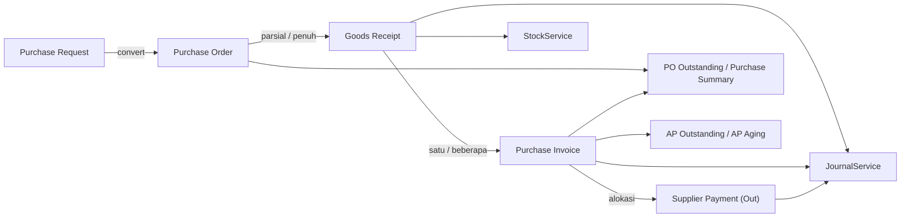

### State machine dan pelacakan qty

- Semua dokumen memakai status `draft -> approved -> closed`; `cancelled` hanya dari draft.
- `purchase_order_items.received_qty_base` dan `invoiced_qty_base` adalah akumulasi qty base. `goods_receipt_items.invoiced_qty_base` melacak sisa per GR.
- PO otomatis `closed` saat seluruh baris diterima penuh. `closed_manually` membedakan penutupan manual dari otomatis, sehingga disapprove GR hanya membuka kembali PO yang ditutup otomatis.
- Disapprove ditolak bila ada dokumen turunan aktif:
  - PR tidak boleh disapprove bila sudah dikonversi menjadi PO aktif.
  - PO tidak boleh disapprove bila masih ada GR draft/approved.
  - GR tidak boleh disapprove bila sudah ditagih PI draft/approved.
  - PI tidak boleh disapprove bila sudah memiliki pembayaran.

### Perhitungan PO

- `qty_base` dihitung `UnitConversionService::toBase()`.
- `unit_price_base` adalah harga bersih per satuan base tanpa pajak:
  `unit_price * (1 - discount_pct / 100)` dikonversi ke base dan dibulatkan 4 desimal.
- `line_total = round(qty_base * unit_price_base, 2)`.
- Subtotal = jumlah nilai bruto per baris; diskon = selisih bruto dan `line_total`.
- PPN = `round((subtotal - diskon) * tax_rate / 100, 2)`; total = basis + PPN. Semua uang 2 desimal HALF_UP.
- `unit_price_base` menjadi biaya GR sehingga nilai persediaan dan GR/IR konsisten dengan PO bersih.

### Goods Receipt

- Hanya dari PO `approved`.
- Parsial diperbolehkan. Batas qty = sisa PO `(qty_base - received_qty_base)` ditambah `gr_over_receipt_tolerance_pct` (setting, default 0). Validasi diulang di bawah lock saat approve.
- Approve:
  1. lock header GR -> periode -> header PO -> baris PO -> saldo stok;
  2. `StockService::receive()` per baris pada `unit_price_base` PO;
  3. jurnal `Dr Persediaan per kategori item / Cr GR/IR` lewat `JournalService`;
  4. tambah `received_qty_base` dan sesuaikan status PO.
- Approve idempoten. Disapprove membalik stok dan jurnal, mengurangi `received_qty_base`, dan menolak bila periode closed atau ada mutasi lanjutan.

### Purchase Invoice

- Satu PI dapat menagih beberapa GR dari supplier yang sama.
- Qty per baris dibatasi sisa GR (`qty_base - invoiced_qty_base`). `invoiced_qty_base` pada GR dan PO dinaikkan saat approve.
- `due_date = doc_date + suppliers.payment_term_days`.
- Jurnal:
  - `Dr GR/IR` sebesar `qty_base * gr_unit_cost` yang ditagih;
  - `Dr PPN Masukan` sebesar `tax_amount`;
  - `Dr/Cr Selisih Harga Pembelian` sebesar `subtotal - nilai GR`;
  - `Cr Hutang Usaha` sebesar total invoice.
- Disapprove membalik jurnal dan mengurangi `invoiced_qty_base`; ditolak bila sudah ada pembayaran.

### Payment Out

- Alokasi ke banyak invoice, boleh parsial. Total alokasi wajib sama dengan `amount`, dan setiap alokasi tidak boleh melebihi `total - paid_amount`.
- `method=cash|bank`; akun diambil dari `account_id` eksplisit atau `account_settings` (`cash_default`/`bank_default`).
- Approve: lock payment -> periode -> invoice (urut id) -> jurnal `Dr Hutang Usaha / Cr Kas atau Bank` -> naikkan `paid_amount`.
- Disapprove membalik jurnal dan mengembalikan `paid_amount`.

### Laporan dan cetak

- **PO Outstanding**: PO approved yang masih memiliki sisa diterima/ditagih, nilai outstanding = sisa qty * `unit_price_base`.
- **Purchase Summary**: agregasi invoice approved per supplier (jumlah, subtotal, PPN, total).
- **AP Outstanding**: invoice approved dengan `total > paid_amount`, due date, dan hari keterlambatan (0 bila belum jatuh tempo).
- **AP Aging**: bucket current, 1-30, 31-60, 61-90, >90 berdasarkan due date.
- **Cetak PO**: DomPDF dari view `purchasing.purchase-order`; nama berkas memakai `doc_no` yang disanitasi karena mengandung `/`.

### Rekonsiliasi

`ReconciliationService` otomatis memeriksa AP (`purchase_invoices` approved) dan Persediaan (`stock_balances`) karena tabelnya sudah ada. Tutup periode akan gagal bila saldo GL Hutang Usaha/Persediaan tidak sama dengan sumber dokumen.

## Modul Sales (Fase 6)

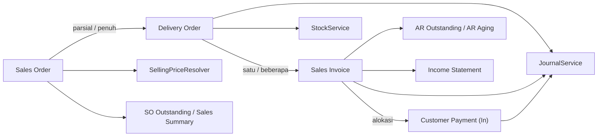

### Harga jual dan credit limit

- SO memakai `SellingPriceResolver` yang sama dengan endpoint lookup: harga khusus customer yang valid lebih diutamakan, lalu harga umum, dengan `valid_from` terbaru menang.
- `unit_price` per satuan input; `unit_price_base` dihitung `UnitConversionService::unitCostPerBase()` sehingga invoice dan laporan memakai harga per satuan base.
- Override harga dibanding harga berlaku membutuhkan permission `sales.sales-order.override-price`. Service memeriksa `request()->user()` lalu `Auth::user()`, sehingga aturan tetap berlaku di HTTP maupun test service.
- Credit limit: setting `credit_limit_enforcement` (`off`, `warn`, `block`). Eksposur = AR outstanding + total SO approved lain + total SO saat ini. Limit `0` dianggap tanpa batas. Mode `warn` mengisi properti runtime `SalesOrder::$creditWarning` yang dikirim sebagai `credit_warning` pada respons create/approve; mode `block` melempar `422 CREDIT_LIMIT_EXCEEDED`.
- SO otomatis `closed` saat seluruh `delivered_qty_base >= qty_base`; `closed_manually` mencegah disapprove DO membuka kembali SO yang ditutup pengguna.

### Delivery Order dan HPP

- DO hanya dari SO approved; qty dibatasi sisa SO dan stok tersedia.
- Approve mengunci header DO -> periode -> header/baris SO -> saldo stok, lalu memanggil `StockService::issueWithValue()` per baris. Average cost saat keluar disimpan di `cogs_unit_cost_base`; nilai keluar disimpan di `total_cogs`.
- Jurnal `Dr HPP per kategori item / Cr Persediaan per kategori item`. Kedua sisi memakai nilai yang sama dari ledger sehingga seimbang dan konsisten dengan `stock_balances`.
- Disapprove membalik stok lewat `StockService::reverse()` dan membalik jurnal; ditolak bila periode closed, DO sudah ditagih, atau ada mutasi lanjutan.

### Sales Invoice

- Satu SI dapat menagih beberapa DO dari customer yang sama. Harga diambil dari `sales_order_items.unit_price` dan `unit_price_base` saat invoice dibuat.
- Qty dibatasi sisa `delivery_order_items.qty_base - invoiced_qty_base`; approve menaikkan `invoiced_qty_base` pada DO dan SO.
- `due_date = doc_date + customers.payment_term_days`.
- Mode `draft`/`final`: draft dapat diubah dan belum berjurnal; final sudah diposting. Approve selalu mengubah mode menjadi final. Create dengan `mode=final` membuat draft lalu langsung approve.
- Jurnal: `Dr Piutang Usaha` sebesar total, `Cr Penjualan per kategori` sebesar subtotal, `Cr PPN Keluaran` sebesar pajak.
- Disapprove ditolak bila sudah ada pembayaran/alokasi; jika aman, jurnal dibalik dan `invoiced_qty_base` dikurangi.

### Customer Payment

- Alokasi parsial ke banyak invoice; total alokasi wajib sama dengan `amount`, dan setiap alokasi tidak boleh melebihi `total - paid_amount`.
- `method=cash|bank`; akun dari `account_id` eksplisit atau `account_settings` (`cash_default`/`bank_default`).
- Approve: lock payment -> periode -> invoice (urut id) -> jurnal `Dr Kas/Bank / Cr Piutang Usaha` -> naikkan `paid_amount`.
- Disapprove membalik jurnal dan mengembalikan `paid_amount`.

### Laporan dan cetak

- **SO Outstanding**: SO approved dengan sisa dikirim/ditagih; nilai outstanding = sisa qty * `unit_price_base`.
- **Sales Summary**: agregasi invoice approved per customer.
- **AR Outstanding** dan **AR Aging**: invoice approved dengan `total > paid_amount`, hari keterlambatan dihitung dari due date dengan minimum 0.
- **Income Statement**: pendapatan (kredit - debit), HPP dan beban (debit - kredit) dari jurnal posted/reversed; laba kotor = pendapatan - HPP, laba bersih = laba kotor - beban. Mengikuti ADR 0004 tanpa jurnal penutup.
- **Cetak**: DomPDF untuk `sales.delivery-order` (Surat Jalan) dan `sales.sales-invoice` (Invoice). Nama berkas memakai `doc_no` yang disanitasi karena mengandung `/`.

### Rekonsiliasi

`ReconciliationService` otomatis memeriksa AR (`sales_invoices` approved) dan Persediaan (`stock_balances`) karena tabelnya sudah ada. Tutup periode gagal bila saldo GL Piutang/Persediaan tidak sama dengan sumber dokumen.

### Asumsi

- Sales Return belum diimplementasikan (opsional pada fase ini).
- Override harga dicatat sebagai bagian dari audit SO, bukan tabel terpisah.
- Credit limit memakai total SO approved sebagai eksposur komitmen, bukan hanya AR.

## Modul Persediaan (Fase 4)

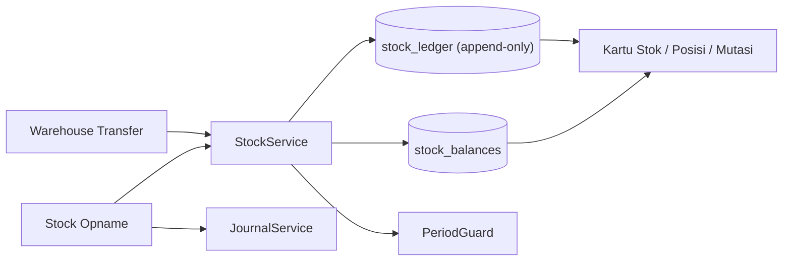

### Skema dan integritas

- `stock_ledger` append-only: tanpa `updated_at`, trigger PostgreSQL menolak `UPDATE` dan `DELETE`. Setiap baris hanya boleh berisi qty masuk **atau** qty keluar, bukan keduanya.
- `reversal_of_id` menunjuk baris asal; unique partial index memastikan satu baris hanya dibalik sekali.
- `stock_balances` unik per `(item_id, warehouse_id)` dan menyimpan qty base, average cost 4 desimal, serta nilai persediaan 2 desimal.
- `warehouse_transfers` + item, `stock_opnames` + item memakai pola dokumen yang sama: `doc_no`, `doc_date`, `period_id`, status, audit, dan soft delete pada header.

### Moving average

- Penerimaan: `avg_baru = (qty_lama * avg_lama + qty_masuk * biaya_masuk) / (qty_lama + qty_masuk)`.
- Pengeluaran memakai average saat itu; average tidak berubah karena pengeluaran.
- Nilai persediaan berjalan adalah jumlah nilai baris bertanda, sehingga `balance_value` selalu sama dengan `SUM` ledger. Saat qty habis, nilai baris terakhir dikoreksi agar saldo nilai menjadi nol. Pengeluaran parsial tidak boleh membuat nilai persediaan negatif.
- Contoh uji: 1.440 @10.000 lalu 1.440 @12.000 menghasilkan avg 11.000 dan nilai 31.680.000; keluar 720 menghasilkan HPP 7.920.000.

### Satu pintu mutasi dan lock

- `StockService::receive()`, `issue()`, `issueWithValue()`, dan `reverse()` adalah satu-satunya penulis ledger dan saldo.
- Saldo dikunci `FOR UPDATE` dengan urutan `item_id ASC, warehouse_id ASC`. Dokumen multi-baris memanggil `lockBalances()` sebelum mutasi.
- Urutan lock transaksi: header dokumen -> periode -> saldo -> sequence jurnal. Urutan ini dipakai transfer, stock opname, dan reverse untuk menghindari deadlock.
- Stok negatif ditolak `422 STOCK_INSUFFICIENT` dengan pesan yang menyebut item, gudang, stok tersedia, dan qty diminta. Setting `allow_negative_stock=true` dapat mengizinkan saldo negatif.

### Pembalikan dan disapprove

- Reverse membuat baris baru dengan arah qty ditukar dan nilai asli, bukan mengubah baris lama. Lihat [ADR 0005](ADR/0005-ledger-immutable-dan-reversal.md).
- Reverse hanya membalik baris aktif. Baris yang sudah memiliki reversal tidak dibalik lagi, sehingga approve -> disapprove -> approve -> disapprove aman.
- Reverse ditolak bila periode closed, ada mutasi lanjutan pada item/gudang yang sama, atau pembalikan membuat stok negatif.
- Aturan disapprove lengkap ada di [ADR 0006](ADR/0006-aturan-disapprove.md). Pemeriksaan dokumen turunan dilakukan oleh action dokumen pemilik turunan pada fase berikutnya.

### Transfer gudang

- Approve mengeluarkan stok dari gudang asal pada average asal, lalu menerima qty dan nilai yang sama di gudang tujuan. Total nilai persediaan tidak berubah.
- Tidak ada jurnal karena perpindahan hanya terjadi di dalam satu entitas.
- Disapprove membalik kedua sisi mutasi dan mengembalikan dokumen ke draft.

### Stock opname

- Draft menyimpan snapshot sistem untuk tampilan. Saat approve, saldo terkini dibaca ulang di bawah lock, sehingga hasil akhir selalu sama dengan qty hitung fisik.
- Selisih minus: `Dr Selisih Persediaan / Cr Persediaan`. Selisih plus: `Dr Persediaan / Cr Selisih Persediaan`. Akun persediaan mengikuti kategori item lewat `AccountMapper`.
- Jurnal dibuat lewat `JournalService`, sehingga wajib seimbang dan periode harus open. Jika seluruh selisih nol, tidak ada mutasi dan tidak ada jurnal.
- Disapprove membalik stok lalu jurnal penyesuaian dalam satu transaksi.

### Laporan

- **Kartu Stok** (`/reports/stock-card`): saldo awal per gudang, mutasi bertanggal, saldo berjalan qty/nilai, average berjalan, dan saldo akhir.
- **Posisi Stok** (`/reports/stock-position`): saldo awal, masuk, keluar, dan akhir per item dan gudang dalam periode.
- **Mutasi Stok** (`/reports/stock-movement`): daftar baris ledger dalam periode beserta total qty/nilai masuk dan keluar.
- Laporan menghitung saldo berjalan dari mutasi bertanggal, bukan hanya dari kolom saldo ledger, sehingga dokumen bertanggal mundur tetap tampil konsisten.

### Asumsi

- Dokumen persediaan diharapkan diposting berurutan sesuai tanggal. Kolom `balance_qty`/`balance_value` pada ledger mengikuti urutan posting (id), sedangkan laporan menghitung ulang urutan tanggal.
- Belum ada dokumen turunan pada Fase 4; pemeriksaan turunan ditambahkan saat Purchasing/Sales dibuat.

## Modul Pelaporan dan Dashboard (Fase 7)

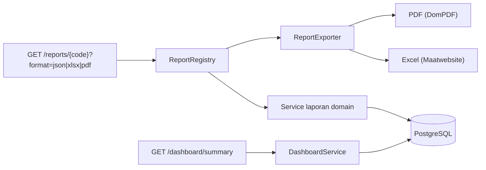

### Laporan

- **Laba Rugi**: multi-level per akun induk, komparatif terhadap periode sebelumnya, dengan laba kotor, laba operasi, dan laba bersih.
- **Neraca**: komparatif dua tanggal (default akhir bulan sebelumnya), memuat aset, kewajiban, ekuitas, dan baris sintetis `3-3000 Laba Tahun Berjalan`. Laba tahun berjalan dihitung dari jurnal pendapatan/HPP/beban sejak awal tahun sampai tanggal laporan (ADR 0004).
- **Kas/Bank**: saldo awal, mutasi, saldo berjalan, dan saldo akhir untuk akun `cash_default` dan `bank_default`.
- **Jurnal**: daftar jurnal posted/reversed beserta baris dan total, filter `source_type` dan `status`.
- **Rekonsiliasi**: empat pemeriksaan (AP, AR, Persediaan, GR/IR) dengan status `OK`, `MISMATCH`, atau `SKIPPED` bila tabel sumber belum ada. `PeriodClosingService` memakai daftar MISMATCH yang sama.
- **Persediaan dan purchasing/sales**: Kartu Stok, Posisi Stok, Mutasi Stok, AP/AR Aging, AP/AR Outstanding, SO/PO Outstanding, Sales/Purchase Summary.

### Ekspor tunggal

`ReportExporter` menormalisasi setiap laporan menjadi `{title, headings, rows, meta}` lalu menulis Excel atau PDF. `GET /reports/{code}` melayani JSON, `?format=xlsx`, dan `?format=pdf` dengan builder yang sama, sehingga tidak ada duplikasi logika per format. Hak akses memakai `report.{code}.view`.

### Dashboard

`GET /dashboard/summary` mengembalikan penjualan dan pembelian bulan berjalan, nilai persediaan, AP/AR outstanding, seri penjualan enam bulan, item di bawah stok minimum, dan jumlah dokumen draft yang menunggu approval.

### Indeks dan performa

Migrasi `2026_11_20_040000_add_reporting_indexes` menambahkan:

- `journals (status, journal_date)` untuk filter jurnal posted/reversed per rentang.
- `journal_lines (journal_date, id)` untuk saldo awal dan slice periode.
- `stock_ledger (item_id, movement_date, id)` untuk Kartu Stok lintas gudang.
- `purchase_invoices (status, doc_date, supplier_id)` dan `(status, due_date)`.
- `sales_invoices (status, doc_date, customer_id)` dan `(status, due_date)`.

Data performa tidak masuk `DatabaseSeeder` agar `make demo` tetap cepat. Jalankan manual:

```bash
docker compose -p minierp-dev exec -T app php artisan db:seed --class=PerformanceSeeder --force
```

Default 10.000 jurnal x 2 baris = 20.000 baris jurnal. Jumlah dapat diubah lewat `PERF_JOURNAL_COUNT`.

### EXPLAIN ANALYZE General Ledger

Dataset: 20.000 baris jurnal, satu akun kas, satu bulan penuh. Query General Ledger dengan window function.

```
Sort  (actual time=98.610..99.137 rows=10000 loops=1)
  Sort Method: quicksort  Memory: 1634kB
  Buffers: shared hit=668
  ->  WindowAgg  (actual time=29.933..41.738 rows=10000 loops=1)
        ->  Sort  (actual time=29.902..30.781 rows=10000 loops=1)
              ->  Nested Loop Left Join  (actual time=5.983..20.611 rows=10000 loops=1)
                    ->  Nested Loop Left Join  (actual time=0.049..0.060 rows=1 loops=1)
                          ->  Seq Scan on accounts a  (actual time=0.018..0.026 rows=1 loops=1)
                                Filter: (is_postable AND is_active AND (id = '6657'::bigint))
                          ->  Index Scan using journal_lines_account_date_idx on journal_lines jl_1
                                Index Cond: ((account_id = '6657'::bigint) AND (journal_date < ...))
                    ->  Hash Join  (actual time=5.932..18.009 rows=10000 loops=1)
                          ->  Seq Scan on journal_lines jl  (actual time=0.011..8.739 rows=10000 loops=1)
                                Filter: ((account_id = '6657'::bigint) AND (journal_date BETWEEN ...))
                          ->  Hash  (actual time=5.808..5.810 rows=10000 loops=1)
                                ->  Seq Scan on journals j  (actual time=0.528..3.249 rows=10000 loops=1)
                                      Filter: ((status)::text = ANY ('{posted,reversed}'::text[]))
Planning Time: 57.270 ms
Execution Time: 100.770 ms
```

Catatan: planner memilih seq scan pada `journal_lines` karena seluruh 20.000 baris berada dalam rentang tanggal dan akun yang diminta. Untuk akun dengan riwayat panjang dan rentang sempit, `journal_lines_account_date_idx` dipakai langsung seperti pada CTE `opening`. Target < 500 ms terpenuhi (≈101 ms).

### EXPLAIN ANALYZE Kartu Stok

Dataset: 20.000 baris `stock_ledger` untuk satu item dan gudang dalam satu bulan.

```
WindowAgg  (actual time=0.159..92.769 rows=20000 loops=1)
  Buffers: shared hit=9354
  ->  Index Scan using stock_ledger_item_date_idx on stock_ledger l
        (actual time=0.138..13.376 rows=20000 loops=1)
        Index Cond: ((item_id = 144) AND (movement_date >= ...) AND (movement_date <= ...))
        Filter: (warehouse_id = '115'::bigint)
Planning Time: 2.432 ms
Execution Time: 93.860 ms
```

Indeks baru `(item_id, movement_date, id)` membuat slice Kartu Stok tetap di bawah 100 ms.

## Keamanan

- Sanctum bearer token dengan masa berlaku dari `SANCTUM_EXPIRATION`.
- Rate limit `api` per user atau IP, rate limit `login` per email dan IP.
- CORS dibatasi ke origin yang didaftarkan di `CORS_ALLOWED_ORIGINS`.
- Respons error tidak pernah membocorkan stack trace. Detail internal hanya masuk log.
- `.env` tidak masuk repo, hanya `.env.example`.
- Dokumen OpenAPI terbuka secara default untuk demo (`API_DOCS_PUBLIC=true`); matikan bila instance memakai data nyata.

## Container

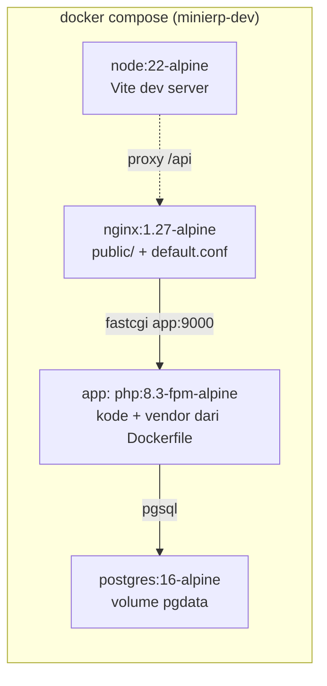

### Isolasi VPS dan batas sumber daya

Proyek Compose memakai nama `minierp-dev`. Semua target Makefile menjalankan `docker compose -p minierp-dev`, sehingga container, network, dan volume proyek lain (Coolify, Minecraft, database aplikasi lain) tidak tersentuh. Semua port dipublikasikan ke loopback dan dapat diubah lewat `.env` root:

| Layanan | Port host default | Variabel |
| --- | --- | --- |
| API/nginx | `127.0.0.1:8100` | `APP_PORT` |
| PostgreSQL | `127.0.0.1:5433` | `POSTGRES_PORT` |
| Vite | `127.0.0.1:5173` | `FRONTEND_PORT` |

Batas memori dan CPU dipasang di Compose: postgres `768m`/`0.5` CPU, app `768m`/`1.0` CPU, nginx `128m`, node `768m`. Total batas sekitar 2,4 GB, di bawah pagu 3 GB. Layanan `node` berada di profil `frontend`; `make demo` dan `make smoke` hanya menyalakan postgres, app, dan nginx. Nyalakan Vite secara eksplisit dengan `make fe-up`.

Dua cara image dipakai:

| Konteks | Berkas Compose | Kode aplikasi |
| --- | --- | --- |
| Pengembangan lokal | `docker-compose.yml` + `docker-compose.override.yml` (otomatis) | Bind mount `./backend`, `vendor` dipasang entrypoint bila belum ada |
| CI dan demo | `docker-compose.yml` saja | Hasil `COPY` di Dockerfile, tanpa bind mount |

Dockerfile memakai tiga tahap: `base` (php:8.3-fpm-alpine dengan ekstensi `pdo_pgsql`, `bcmath`, `intl`, `zip`, `gd`, `opcache`), `vendor` (Composer memasang dependensi di atas `base` yang sama), dan runtime yang menyalin kode serta vendor. Karena `vendor` memakai `base`, Composer memverifikasi requirement terhadap platform yang identik dengan runtime, bukan image Composer yang PHP-nya berbeda. Entrypoint menyiapkan `.env`, menulis koneksi database dari environment Compose, menghasilkan `APP_KEY`, dan menyesuaikan kepemilikan `storage` serta `bootstrap/cache` untuk user `www-data`. Karena image sudah membawa vendor, container di CI siap tanpa `composer install` saat runtime.

Koneksi database ditulis eksplisit ke `.env` oleh entrypoint, bukan hanya mengandalkan variabel lingkungan container. Alasannya: perilaku `clear_env` pada php-fpm dan urutan prioritas dotenv berbeda antar setup, dan salah satu kombinasi bisa membuat worker menyambung ke `127.0.0.1` alih-alih service `postgres`.

`.dockerignore` mengecualikan `backend/vendor`, `**/.env`, dan `frontend`, sehingga konteks build kecil dan tidak pernah membawa rahasia dari mesin pengembang. `.gitattributes` memaksa LF pada `*.sh`, `Dockerfile`, dan `Makefile` agar checkout di Windows tidak merusak `#!/bin/sh`.

## Verifikasi Docker

Job `docker-smoke` di CI menjalankan urutan yang sama dengan `make smoke`:

1. `docker compose config --quiet`.
2. `docker compose build`.
3. `docker compose up -d --wait --wait-timeout 180 postgres app nginx` (tiga menit untuk ketiga layanan backend healthy).
4. `docker compose exec -T app php artisan migrate --force`.
5. `curl` ke `/api/v1/health`, wajib HTTP 200 dan `checks.database = ok` (divalidasi `jq`).
6. `docker compose logs postgres app nginx` bila gagal, lalu `docker compose down -v --remove-orphans`.

Karena job ini tidak memuat `docker-compose.override.yml`, image yang diuji adalah image yang benar-benar dipakai untuk demo.

Layanan `node` sengaja tidak dinyalakan. Endpoint health hanya bergantung pada postgres, php-fpm, dan nginx; frontend sudah diuji job `frontend` (ESLint, typecheck, build). Akibatnya job smoke tidak menarik image Node, tidak menjalankan `npm ci`, dan tidak bergantung pada registry npm.

Konsekuensi yang perlu diketahui: `make smoke` dan job CI tidak memvalidasi integrasi Vite di dalam Compose. Perubahan pada `frontend/docker-entrypoint.sh` atau konfigurasi proxy diuji terpisah lewat `make fe-up`/`make fe-build`.

## Kualitas

- Pint dengan `declare(strict_types=1)` dan urutan import.
- Larastan level 6 pada `app`, `routes`, dan `database`.
- Pest dengan `RefreshDatabase`, memakai database PostgreSQL terpisah.
- ESLint dan `tsc` strict untuk frontend.

## Batasan fase 0

- Belum ada endpoint domain, login, maupun seeder data.
- ERD dan ADR ditulis saat modul terkait mulai diimplementasikan, agar isinya sesuai kode yang ada.
- Stack Compose dijalankan di VPS bersama dengan batas sumber daya dan port loopback; kebenarannya juga dijaga oleh job `docker-smoke`.
